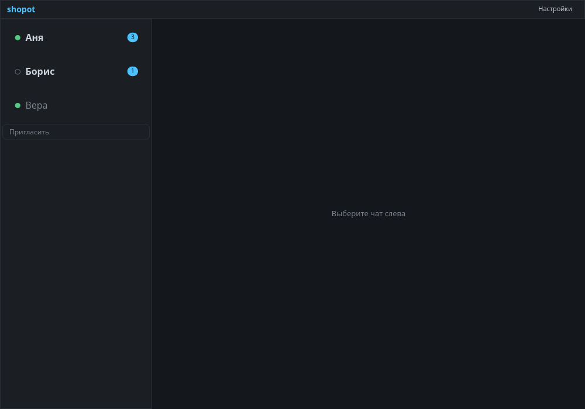

# shopot

[](https://github.com/EryyynIT/shopot/actions/workflows/ci.yml)

Desktop GUI client for [shopot-core](https://github.com/Puxxalwl/shopot-core/) —
a serverless P2P messaging engine with end-to-end encryption and forward secrecy.

Built with [iced](https://github.com/iced-rs/iced) on the tiny-skia software
renderer in Rust: dark TUI-derived palette, one accent color, honest send
statuses, no fake delivery receipts.

[README на русском](README.ru.md)



## Status

First release: **v0.1.0 «Разговор»**. The client talks to a real `shopot serve`
daemon over its binary frame API 1.0.0 on a Unix domain socket
(`$HOME/.shopot/api.sock`); `--mock` runs a built-in demo scene instead.

Not production-ready: no message history, files, avatars or calls yet (they
land in v0.2 and v0.3). OS notifications and full keyboard control are next
(v0.1.1).

Done so far:

- typed core link: binary frame codec, request correlation, events, reconnect
  with resync; an e2e test runs invite → message → delivery ACK against two
  real daemons (gated by `SHOPOT_BIN`)
- meeting flow: one-time invite codes with a QR, adding a contact by someone
  else's code
- contacts list with presence dots and unread badges
- message feed with day separators, system events and honest send statuses
  (sending → sent / queued / delivered / failed)
- contact card and right-click menu with block/unblock; Escape closes any
  dialog
- auto-growing composer with a send button
- headless UI tests (`iced_test`) plus unit tests; CI runs fmt, clippy, tests,
  a release build and cargo-deny on every push

## Download

Releases ship one archive with the client, the daemon and a launcher for
Linux x86_64 — no toolchains needed:

```sh
tar -xzf shopot-v0.1.0-x86_64-linux-gnu.tar.gz
cd shopot && ./run.sh
```

`run.sh` creates your identity on first start, runs the daemon in the
background and opens the client. Building from source is below.

## Build and run

Requires a stable Rust toolchain and [Zig 0.17.0](https://ziglang.org/) for
the daemon.

```sh
# the engine: build once, init your identity, run the daemon
cd core/zig && zig build -Doptimize=ReleaseSafe && cd ../..
./core/zig/zig-out/bin/shopot-zig init
./core/zig/zig-out/bin/shopot-zig serve

# the client, in another terminal
cargo run --release
```

To meet someone, press «Пригласить» in the sidebar and press «Выдать код»:
you get a one-time invite code with a QR — hand it over out of band. To add
a contact, paste their code into «Вставить чужой код» and press «Добавить»;
the chat opens once both sides are known to the daemon. Right-click a contact
to block or unblock them; Escape closes any dialog.

Meeting across the internet (different networks, different cities): a code
without an address only works inside one LAN. The daemon prints
«слушаю 0.0.0.0:PORT» on start — forward that port on your router, then type
your public `host:port` into «Адрес» before issuing: the peer's daemon dials
you directly. The «через relay» checkbox routes the
connection through a `shopot relay` server so the peer never sees your IP;
on the pinned daemon build this path is experimental — the address code is
the reliable one.

## The core

shopot itself is the client; the engine — encrypted P2P transport, sessions,
storage — lives in [shopot-core](https://github.com/Puxxalwl/shopot-core) by
[puxxalwl](https://github.com/puxxalwl). The pinned API contract is vendored
as the `core` git submodule (binary protocol spec:
`core/zig/docs/CORE-API.md`).

## License

[MIT](LICENSE)
